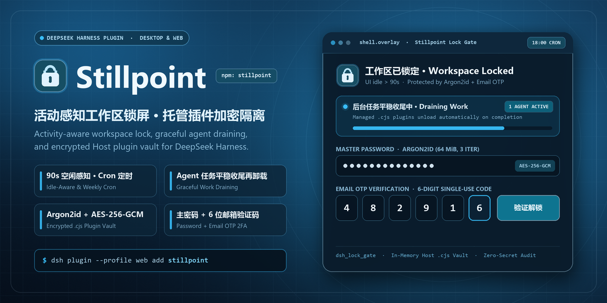

# Stillpoint

[简体中文](README.md) · English



**Stillpoint** (npm package: `stillpoint`) is an **activity-aware workspace lock and encrypted host-plugin lifecycle manager** for **DeepSeek Harness (DSH)** Desktop and Web. It supports weekly-preset or five-field Cron scheduled locking as well as instant manual locking: when a scheduled lock comes due, Stillpoint waits for the UI to go idle (90 seconds without clicks, typing, or scrolling, or when the window moves to the background), displays the lock screen, and lets DSH-tracked agents and background jobs finish gracefully before unloading managed Host `.cjs` plugins. Managed plugin source code and SMTP credentials are encrypted at rest with **Argon2id + AES-256-GCM**, and unlocking requires both a **master password** and a **six-digit email verification code (Email OTP)**.

## When to Use Stillpoint (Comparison)

When you step away from your desk, finish work for the day, or run DeepSeek Harness on a shared workstation without wanting to kill long-running agent tasks, Stillpoint bridges the gap between an OS screen lock and a static web login gate:

| Dimension | OS Screen Lock | Generic Web Auth Proxy | Stillpoint (`stillpoint`) |
| --- | --- | --- | --- |
| **Protection layer** | Whole desktop session | HTTP / WebSocket ingress | In-app DSH overlay (`shell.overlay`) + Cordis child-plugin lifecycle |
| **UI activity awareness** | System-wide keyboard/mouse idle | Usually none | Defers scheduled lock while DSH is focused and active within the last 90s |
| **Running DSH agents & jobs** | Sleep/suspend can interrupt runs | Blocks UI, plugins stay active in RAM | **Graceful draining**: locks UI first, waits for tracked agents & jobs to finish, then unloads managed plugins |
| **Sensitive plugin isolation** | Plaintext files remain loaded | Plugins stay resident in host process | Stores `.cjs` source in an Argon2id + AES-256-GCM vault; compiles in memory on unlock and unloads on lock |
| **Unlock factors** | OS password / biometrics | Password or session cookie | Master password (≥12 chars) + single-use 6-digit Email OTP (QQ Mail preset or custom SMTP) |

## Key Capabilities & Technical Specifications

| Component | Implementation Details |
| --- | --- |
| **Package & compatibility** | npm: `stillpoint` (`v1.0.10`) · Node.js `>=22` · DSH Desktop & Web `>=0.2.2-rc.5 <0.3.0` |
| **Lock triggers** | Manual lock, weekly schedule preset (defaults to Mon–Fri `18:00` `Asia/Shanghai`, disabled initially), 5-field Cron, locked-on-restart boot gate, and downtime catch-up check |
| **Activity & work detection** | 25s UI activity leases, 90s foreground interaction grace window, 5s check cadence; tracks live DSH agents (`running`) and background jobs (`running` / `stopping`) |
| **Cryptography & vault** | Worker-thread Argon2id (`64 MiB` memory, 3 iterations, parallelism 1) + domain-separated AES-256-GCM encryption for managed plugin source and SMTP authorization codes |
| **Email OTP verification** | 6-digit one-time code (HMAC-SHA256 verified, 10-minute TTL); 5-minute cooldown after 5 failed attempts; rate-limited to 1 email/minute and 5 emails/hour |
| **Managed Host plugins** | Self-contained `.cjs` plugins up to `128 KiB` (`module.exports = (ctx) => {}` or `{ apply(ctx) }`), compiled in memory without plaintext temp files or `require.cache` entries |
| **Audit log** | Dedicated `dsh_lock_gate_audit` storage domain retaining up to 500 events over 15 days (event types and planned/actual timestamps only; zero secrets logged) |

## Installation

Verified with DSH Desktop and Web `0.2.2-rc.5`.

### Install via CLI or npm

```sh
dsh plugin --profile web add stillpoint
```

Replace `--profile web` with `--profile desktop` for the Desktop profile. If a newly published npm release is still within DSH's 24-hour release-age window or pending registry sync, you can install the prebuilt GitHub Release tarball directly:

```sh
dsh plugin --profile web add https://github.com/Lubin-Github/stillpoint/releases/download/v1.0.11/stillpoint-1.0.11.tgz
```

Refresh the interface after applying the installation. Open **Settings → Stillpoint** or follow the setup prompt. Manual and scheduled locking become available after the SMTP test succeeds.

### Install from Discover

1. Open **Plugins → Experimental Plugins** and enable **Custom Plugin Indexes**.
2. Open **Discover → Add Index Source** and paste this URL:

   ```text
   https://raw.githubusercontent.com/Lubin-Github/stillpoint/main/plugin-index.json
   ```

3. Search for **Stillpoint**, confirm that the source is `Lubin-Github/stillpoint`, and install it. The index pins each version to a Git commit.

### Package and install from source

You need Node.js 22 or later and npm.

```sh
git clone https://github.com/Lubin-Github/stillpoint.git
cd stillpoint
npm ci --ignore-scripts
npm pack --ignore-scripts
```

In the DSH plugin manager, install the generated `stillpoint-1.0.11.tgz` using its absolute path. Refresh the interface after applying the installation. Open **Settings → Stillpoint** or follow the setup prompt. Manual and scheduled locking become available after the SMTP test succeeds.

## Configure Email and Unlock

1. The setup form defaults to **QQ Mail**. Enter your full `@qq.com` address and the SMTP authorization code generated by QQ Mail. Stillpoint fills in the server, port, and encryption settings and uses the same address for sending and receiving. For another provider, choose **Custom SMTP** and enter its settings. In a browser, use loopback HTTP (`localhost`, `127.0.0.1`, `[::1]`) or HTTPS served directly by DSH.
2. Set a master password of at least 12 characters and save. Select **Send test email** and confirm that the message reached your inbox before locking. SMTP acceptance only confirms that the mail server accepted the message. If you change an already verified configuration, the previous settings continue to handle unlock codes until a test of the new settings succeeds.
3. Lock manually from the settings page or enable **Automatic lock** and choose the days and time. The schedule starts disabled. The preset is Monday through Friday at 18:00 in `Asia/Shanghai`. Use **Advanced · Cron** for more complex five-field schedules. Once SMTP is verified, each DSH host restart starts in the locked state. Startup also checks for scheduled locks that came due during downtime.
4. To unlock, enter your master password to request an email and then submit the master password with the six-digit code. A code expires after 10 minutes and can be used once. Five consecutive failed attempts trigger a five-minute cooldown. Email requests are limited to one per minute and five per hour, including test emails.

## Activity-Aware Scheduled Locking

When a lock is due, Stillpoint waits if the DSH window is in the foreground and you have clicked, typed, or scrolled in the past 90 seconds. When the window goes into the background or that inactivity period elapses, the next check shows the lock screen. Checks normally run every five seconds.

If a DSH agent or a registered background job is still running, the lock screen shows that work is finishing and managed plugins stay loaded. When all tracked work finishes, Stillpoint unloads the managed plugins. You can unlock with your master password and email code while work is finishing. A successful unlock cancels the pending unload. Manual locking unloads managed plugins immediately, and the DSH host starts locked after a restart.

Activity detection covers agents and background jobs that DSH tracks. It has no visibility into other applications or unregistered work that a plugin starts on its own.

## Lock History

Open **Settings → Stillpoint → Lock history** to see startup locks, manual locks, scheduled screen locks, scheduled plugin unloads, successful code-based unlocks, and common errors. Scheduled events show both the planned and actual time. Stillpoint keeps up to 500 events from the last 15 days. It prunes expired events while DSH is running and at the next startup after downtime.

History contains event types and timestamps. If log storage is unavailable, Stillpoint shows that new records are held in memory and keeps the lock and unlock flows available.

## Managed Plugins

Import a self-contained host-side `.cjs` plugin of up to 128 KiB from the settings page. Export a function with `module.exports = (ctx) => { … }`, or export an object with an `apply(ctx)` method. Register timers, listeners, and services on the supplied Cordis context or return a cleanup function. Import only trusted code because managed plugins run with the DSH host process's privileges. Node.js built-in modules are supported. Adapt plugins that use additional files, npm packages, multiple entry points, or a separate Web client before importing them.

Stillpoint stores imported plugin names and source code in an encrypted vault. Locking unloads the Cordis child plugins that Stillpoint started. After verification, it compiles and runs their source in memory without writing a new plaintext entry file or adding it to `require.cache`. You manage the original files and any existing profile entries. Ordinary plugin entries that are still enabled continue to load through DSH. You can test startup and cleanup with a copy before disabling the original entry in the DSH plugin manager.

## Storage, Recovery, and Security Boundaries

Stillpoint derives keys from the master password with Argon2id in a worker using 64 MiB, three iterations, and parallelism of one. It encrypts managed source code and SMTP credentials with AES-256-GCM, using separate keys for different purposes. The stored SMTP credentials are authenticated against their mail settings. Stillpoint reads the SMTP authorization code after master-password authentication when sending email or explicitly updating sender and recipient addresses. Logs omit master passwords, SMTP authorization codes, and verification codes. The host runs synchronous AES operations on bounded inputs, and the JavaScript runtime reclaims in-memory strings.

Keep the master password and a backup of the encrypted storage. If storage cannot be read, DSH shows a recovery notice, preserves the original data, and leaves managed plugins unloaded. If the lock screen reports a connection problem, retry the connection. A confirmed lock keeps the master-password and verification-code fields available. If the mailbox becomes inaccessible or its authorization code expires, restore access to the original mailbox or use a valid configuration backup. Decryption still requires the original master password.

Stillpoint uses DSH's in-app plugin lifecycle. DSH SafeMode can skip third-party plugins, including Stillpoint, so the lock screen may be absent. Encrypted content still requires its key. Existing `cordis.patch.yml` entries, ordinary plugins, open sessions, and other DSH APIs remain subject to the host's rules. People with local filesystem or host administration access can still manage the DSH profile. A host-wide startup gate, an independent SafeMode trust root, bulk migration of existing plaintext, and secure deletion require host support.

## Frequently Asked Questions (FAQ)

### Does Stillpoint interrupt running DSH agents or background jobs when locking?
Not during scheduled automatic locks. Once the scheduled time arrives and the UI has been idle for 90 seconds (or unfocused), Stillpoint immediately puts up the lock screen overlay while keeping managed plugins loaded until all DSH-tracked running agents and background jobs finish. Manual locking unloads managed plugins immediately.

### What happens if I lose my master password or email access?
Managed plugin source code and SMTP credentials are encrypted with keys derived from your master password via Argon2id; there is no backdoor or password reset mechanism. If your mailbox becomes unreachable or its SMTP authorization code expires, restore access to the original mailbox or restore a valid configuration backup—decrypting the vault always requires the original master password.

### Can I use Stillpoint over plain LAN HTTP on DSH Web?
No. Stillpoint's HTTP routes enforce trusted-origin checks: Web access works over loopback HTTP (`localhost`, `127.0.0.1`, `[::1]`) or direct HTTPS served by DSH. Non-loopback plaintext HTTP requests are rejected.

### Are encrypted managed plugins exposed if DSH starts in SafeMode?
No. DSH SafeMode skips third-party bundles including Stillpoint, so the lock overlay will not load, but imported plugin source code and SMTP credentials remain encrypted with Argon2id + AES-256-GCM inside the `dsh_lock_gate` storage domain and cannot be decrypted without the master password.

## Local Verification

```sh
npm ci --ignore-scripts
npm test
npm pack --ignore-scripts
```
