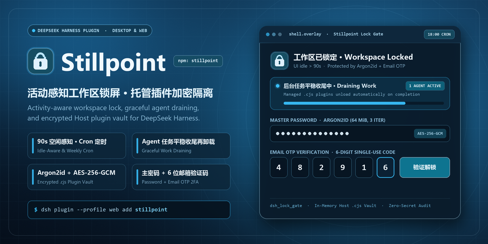

# Stillpoint

简体中文 · [English](https://github.com/Lubin-Github/stillpoint/blob/main/README.en.md)



**Stillpoint**（npm 包名：`stillpoint`）是面向 **DeepSeek Harness（DSH）** Desktop 与 Web 的**活动感知工作区锁屏与托管插件加密卸载插件**。它支持按周预设或五段式 Cron 定时锁屏与手动锁屏：计划时间到达时先等待界面空闲（90 秒无点击、键入或滚动，或窗口切入后台），并在锁屏期间让 DSH 跟踪的活动 Agent 和后台作业平稳跑完，任务全部结束后再自动卸载托管的 Host `.cjs` 插件；插件源码与 SMTP 授权码使用 **Argon2id + AES-256-GCM** 加密存储，解锁需同时通过**主密码 + 六位邮箱动态验证码（Email OTP）**双重校验。

## 适用场景与方案对比

当你需要在离开工位、下班后或共享终端环境中保护 DeepSeek Harness 工作区，同时不希望粗暴中断正在执行的长耗时 Agent 任务时，Stillpoint 填补了系统锁屏与普通前端密码遮罩之间的空白：

| 对比维度 | 操作系统锁屏 | 普通 Web 登录网关 / 前端遮罩 | Stillpoint（本插件） |
| --- | --- | --- | --- |
| **适用层次** | 整机桌面会话 | 浏览器 HTTP / WebSocket 入口 | DSH 应用内锁屏（`shell.overlay`）+ Cordis 托管插件生命周期 |
| **前台活动感知** | 按整机键鼠空闲计时 | 通常无活动感知 | 仅在 DSH 切入后台或连续 90 秒无交互后触发定时锁屏 |
| **长耗时 Agent / 后台任务** | 休眠可能中断任务 | 拦截请求但插件常驻内存 | **平稳收尾**：锁屏先挡住界面，等已登记的 Agent 与后台作业跑完再卸载托管插件 |
| **敏感插件隔离** | 磁盘文件保持原样 | 插件源码与状态常驻加载 | 托管 `.cjs` 源码经 Argon2id + AES-256-GCM 加密入库，解锁后内存编译运行，锁定即卸载 |
| **解锁认证因素** | 系统口令 / 生物识别 | 单一口令或会话 Cookie | 主密码（≥12 字符）+ 一次性六位邮件验证码（支持 QQ 邮箱预设与自定义 SMTP） |

## 核心能力与技术规格

| 模块 | 实际实现规格 |
| --- | --- |
| **包名与运行环境** | npm：`stillpoint`（`v1.0.10`）· Node.js `>=22` · DSH Desktop / Web `>=0.2.2-rc.5 <0.3.0` |
| **触发方式** | 手动立即锁定、按周预设（默认周一至周五 `18:00` `Asia/Shanghai`，初始关闭）、五段式 Cron 表达式、Host 重启默认锁定及停机到期补锁 |
| **活动与任务检测** | 25 秒前端活动租约、90 秒前台交互缓冲、5 秒轮询检查；自动识别运行中的 DSH Agent 与 `running` / `stopping` 后台作业 |
| **密钥派生与加密** | 独立 Worker 执行 Argon2id（`64 MiB` 内存、3 次迭代、并行度 1）；AES-256-GCM 分离派生密钥加密托管插件源码与 SMTP 授权码 |
| **邮件验证码（OTP）** | 6 位数字验证码（HMAC-SHA256 校验，10 分钟有效，单次有效）；连续 5 次输错冷却 5 分钟；发信限流最短间隔 60 秒、每小时最多 5 封 |
| **托管插件规格** | 支持导入最多 `128 KiB` 自包含 Host `.cjs` 插件（`module.exports = (ctx) => {}` 或 `{ apply(ctx) }`），内存编译执行，不写明文临时文件、不入 `require.cache` |
| **锁定审计日志** | 独立 `dsh_lock_gate_audit` 存储域，记录最近 15 天 / 最多 500 条锁定、卸载、解锁与异常事件（不含口令、授权码或验证码） |

## 安装

已验证 DSH Desktop / Web `0.2.2-rc.5`。

### 通过命令行或 npm 安装

```sh
dsh plugin --profile web add stillpoint
```

Desktop 配置可将 `--profile web` 替换为 `--profile desktop`。若新发布的 npm 版本处于 24 小时冷却窗口或尚未同步，可直接从 GitHub Release 安装预打包包：

```sh
dsh plugin --profile web add https://github.com/Lubin-Github/stillpoint/releases/download/v1.0.11/stillpoint-1.0.11.tgz
```

安装应用后刷新界面，打开 **设置 → Stillpoint**，或从首次启动提示进入配置。SMTP 测试通过前，手动锁定与定时锁定均不可用。

### 通过 DSH「发现」安装

1. 打开 **插件 → 实验性插件**，启用 **自定义插件索引**。
2. 在 **发现 → 添加索引源** 中粘贴 `https://raw.githubusercontent.com/Lubin-Github/stillpoint/main/plugin-index.json`。
3. 搜索 **Stillpoint**，确认来源是 `Lubin-Github/stillpoint` 后安装。索引将每个版本固定到对应的 Git 提交。

### 从源码打包安装

需要 Node.js 22 或更新版本及 npm。

```sh
git clone https://github.com/Lubin-Github/stillpoint.git
cd stillpoint
npm ci --ignore-scripts
npm pack --ignore-scripts
```

通过当前 DSH 配置的插件管理器安装生成的 `stillpoint-1.0.11.tgz`（填写本地绝对路径），应用后刷新界面。打开 **设置 → Stillpoint**，或从首次启动提示进入配置。SMTP 测试通过前，手动锁定与定时锁定均不可用。

## 配置 SMTP 与解锁流程

1. 首次配置默认选择 **QQ 邮箱**。填写完整的 `@qq.com` 邮箱地址和 QQ 邮箱生成的 SMTP 授权码。服务器、端口和加密方式自动填写，发件地址与收件地址均使用这个邮箱。其他服务商可选择 **自定义 SMTP**，按服务商说明填写。Web 页面可通过本机回环 HTTP（`localhost` / `127.0.0.1` / `[::1]`）或 DSH 直连 HTTPS 使用此功能。
2. 设置至少 12 个字符的主密码并保存。点击 **发送测试邮件**，确认实际收到测试邮件后再锁定。SMTP 服务器接受邮件与邮箱实际收到邮件是两个步骤。若已有验证通过的 SMTP，修改邮件设置后，旧配置继续负责解锁，直至新配置通过测试。
3. 在同一设置页可手动锁定，或开启 **自动锁定**。直接选择星期和时间，默认时区是北京时间（`Asia/Shanghai`），默认时段为周一至周五 18:00。自动锁定默认关闭。可在 **高级规则（Cron）** 中查看和修改更复杂的五段式计划。SMTP 测试完成后，每次 Host 重启都会从锁定态开始。Host 启动时也会检查停机期间到期的锁定计划。
4. 解锁时先输入主密码申请验证码，再用主密码和邮件中的六位验证码完成解锁。验证码有效期 10 分钟，仅使用一次。连续 5 次失败暂停 5 分钟。发信间隔至少 60 秒，每小时最多 5 次，含测试邮件。

## 自动锁定的活动检测

计划时间到达后，如果 DSH 窗口仍在前台且最近 90 秒有点击、键入或滚动，就等界面空闲。界面切到后台或操作超时后，下一次检查会显示验证码锁屏。正常检查间隔为 5 秒。

如果还有 DSH Agent 或已登记的后台作业在运行，锁屏会提示任务正在收尾，托管插件会继续运行。任务全部结束后自动卸载插件。此时也可以用主密码和邮件验证码解锁，解锁成功会取消本轮待卸载。手动锁定仍立即卸载插件，Host 重启仍从锁定状态开始。

任务检测覆盖 DSH 能识别的 Agent 和后台作业。系统里的其他程序和插件自行启动且未登记的工作无法用于判断空闲。

## 锁定日志

在「设置 → Stillpoint」中展开「锁定日志」。记录启动锁定、手动锁定、定时界面锁定、定时插件卸载、验证码解锁和常见异常。定时记录同时显示原计划时间和实际执行时间。日志保留最近 15 天，最多 500 条。DSH 运行时自动清理，停机期间到期的记录会在下次启动时清理。

日志只保存事件类型和时间。日志存储不可用时，界面会提示记录暂存在内存，锁定和解锁流程仍可运行。

## 托管插件

在设置页导入最多 128 KiB 的自包含 Host `.cjs` 插件。入口使用 `module.exports = (ctx) => { … }`，也可导出含 `apply(ctx)` 的对象。将定时器、监听器和服务注册在传入的 Cordis 上下文，或返回清理函数。仅导入信任的代码，托管插件拥有 DSH Host 进程权限。插件可直接加载 Node 内置模块。依赖其他文件、npm 包、多入口或独立 Web Client 的插件需要先改成受支持的入口形态。

导入后，插件名和源码写入加密库。锁定会卸载通过本插件启动的 Cordis 子插件。验证通过后，源码由内存编译执行，托管入口不生成新明文文件，也不加入 `require.cache`。原始导入文件和已有的 profile 条目由用户管理。若现有插件仍作为普通 profile 条目启用，它会继续按 DSH 的规则加载。可先用一个副本测试启停，确认隔离后再通过正常的 DSH 插件管理入口停用原条目。

## 存储、恢复与安全边界

主密码由独立 Worker 通过 Argon2id 派生密钥，参数为 64 MiB、3 次迭代、并行度 1。插件源码及 SMTP 授权码使用 AES-256-GCM 加密，密钥用途分离，邮件配置与授权码密文做关联校验。主密码通过后仅在发信或显式更新收发地址时读取所需的 SMTP 授权码。主密码、授权码和验证码不会作为日志字段。同步 AES 操作在 Host 上对有限大小的数据执行。内存中的 JavaScript 字符串由运行时回收。

请保留主密码和密文存储备份。存储读取失败时，主界面会显示恢复提示，托管插件保持停用，原有数据会保留。若锁屏只显示服务连接异常，可重新检查连接。已确认锁定时，锁屏会保留主密码和验证码输入。邮箱失联或授权码失效时，需要恢复原邮箱的访问权限或使用有效的配置备份。解密托管内容仍需要原主密码。

当前 DSH 提供的是应用内插件生命周期。SafeMode 可以跳过包括本 bundle 在内的第三方插件，因此该模式可能不显示锁页，已加密的托管内容仍需要密钥。既有 `cordis.patch.yml`、普通插件、已打开的会话和其他 DSH API 仍按宿主规则运行。Web 锁页适用于正常界面操作，具有本机文件权限或 Host 管理权限的人仍可管理 DSH profile。完整启动门禁、SafeMode 独立信任根、现有明文批量迁移及安全删除需要相应的宿主能力。

## 常见问题（FAQ）

### Stillpoint 锁屏时会打断正在运行的 DSH Agent 或后台任务吗？
定时自动锁屏**不会**打断。到达计划时间且界面空闲后，Stillpoint 会先显示锁屏遮罩保护界面，同时保持托管插件继续运行，直到 DSH 跟踪的所有运行中 Agent 与后台作业全部完成后才自动卸载托管插件。若执行“手动锁定”，则会立即卸载托管插件。

### 忘记主密码或邮箱无法接收验证码怎么办？
解密托管插件源码与 SMTP 授权码依赖主密码通过 Argon2id 派生的密钥，**没有后门或重置通道**。若邮箱暂时失联或授权码过期，需恢复原邮箱访问权限或恢复有效的配置备份，且解密托管内容始终需要原主密码。

### 远程局域网 HTTP 访问 DSH Web 时能使用 Stillpoint 吗？
为防止跨站与明文凭据泄露，Stillpoint 服务端路由校验受信来源：浏览器通过本机回环地址（`localhost`、`127.0.0.1`、`[::1]`）的 HTTP 或 DSH 直接提供的 HTTPS 访问时可用；非回环的明文远程 HTTP 请求会被拒绝。

### SafeMode（安全模式）下加密的托管插件会泄露吗？
不会泄露密文内容。DSH SafeMode 会跳过包括 Stillpoint 在内的第三方插件，此时界面不会加载锁屏，但托管插件源码和 SMTP 授权码仍以 Argon2id + AES-256-GCM 密文形式保存在 `dsh_lock_gate` 存储域中，没有主密码无法解密加载。

## 本地验证

```sh
npm ci --ignore-scripts
npm test
npm pack --ignore-scripts
```
